# S1 Worshop 🧠​
____
Anaïs Minel IMAC3
____
## Exercice 1 - ⭐ Ne garder que le vert 

| Avant    |Après| 
| ------------- | :-----------: | 
||| 
____
## Exercice 2 - ⭐ Échanger les canaux 

| Avant    |Après| 
| ------------- | :-----------: | 
||| 
____
## Exercice 3 - ⭐ Noir & Blanc

| Avant    |Après| 
| ------------- | :-----------: | 
||| 
____
## Exercice 4 - ⭐ Négatif 

| Avant    |Après| 
| ------------- | :-----------: | 
||| 
____
## Exercice 5 - ⭐ Dégradé

| Résultat    | 
| ------------- |
|| 
____
## Exercice 6 - ⭐⭐ Miroir

| Avant    |Après| 
| ------------- | :-----------: | 
||| 
____
## Exercice 7 - ⭐⭐ Image bruitée

| Avant    |Après| 
| ------------- | :-----------: | 
|||
____
## Exercice 8 - ⭐⭐ Rotation de 90°

| Avant    |Après| 
| ------------- | :-----------: | 
|||  
____
## Exercice 9 - ⭐⭐ RGB split

| Avant    |Après| 
| ------------- | :-----------: | 
||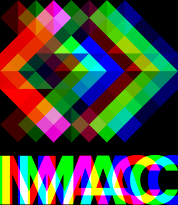| 
____
## Exercice 10 - ⭐⭐ Luminosité

| Avant    |Sombre| Lumineux|
| ------------- | :-----------: | :-----------: | 
||| | 
____
## Exercice 11 - ⭐⭐(⭐) Disque

| Résultat    |
| ------------- |  
|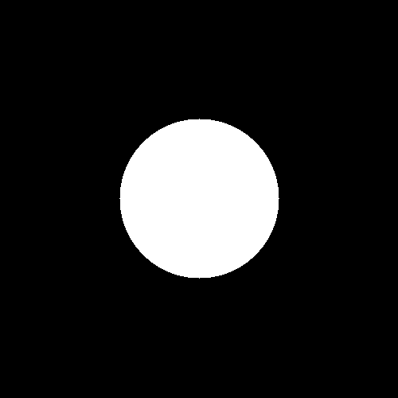|
____
## Exercice 12 - ⭐⭐  Cercle

| Résultat    |
| ------------- |  
|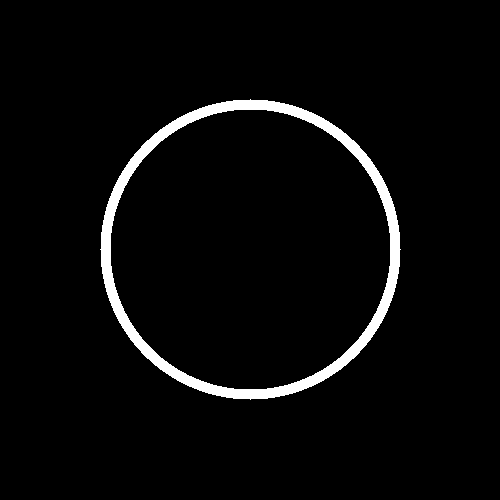|
____
## Exercice 13 - ⭐⭐  Animation
**Résultat frame par frame**

||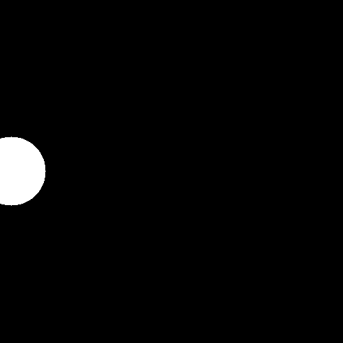|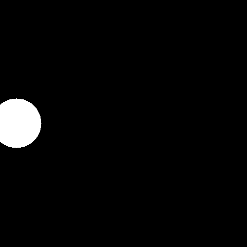|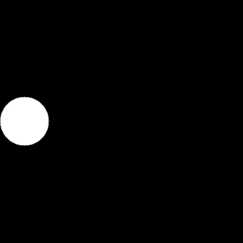|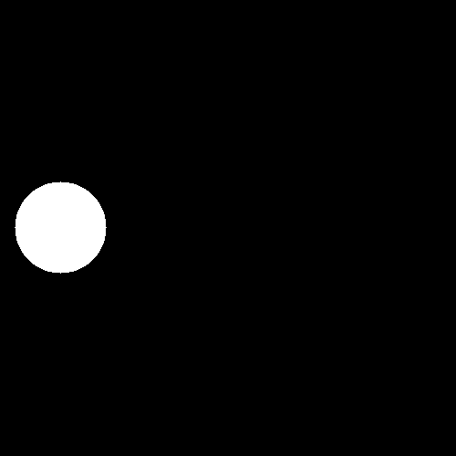|
| ------------- | ------------- | ------------- | ------------- | ------------- |
||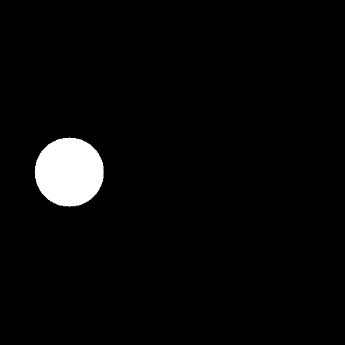|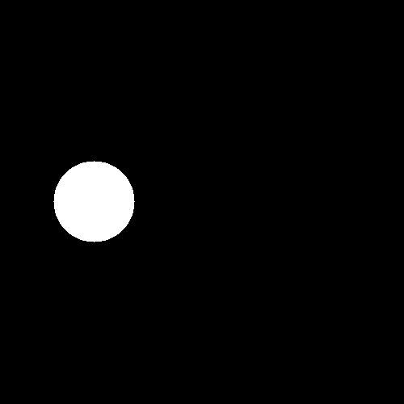|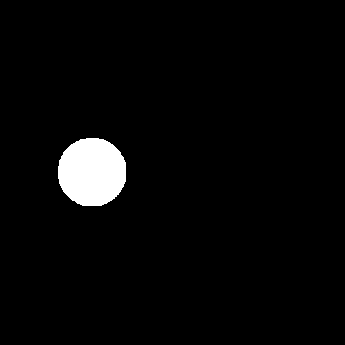||

|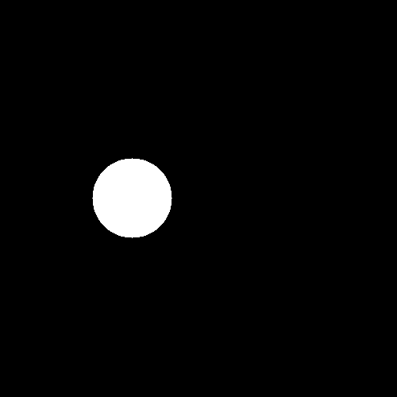|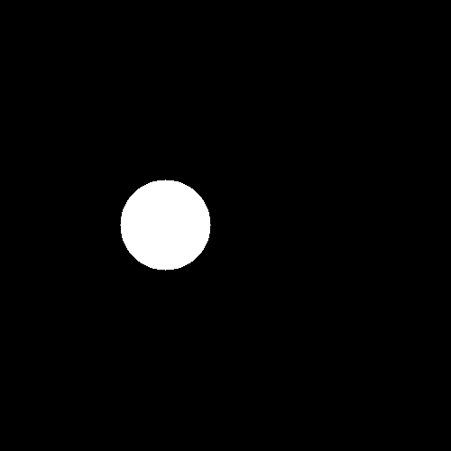|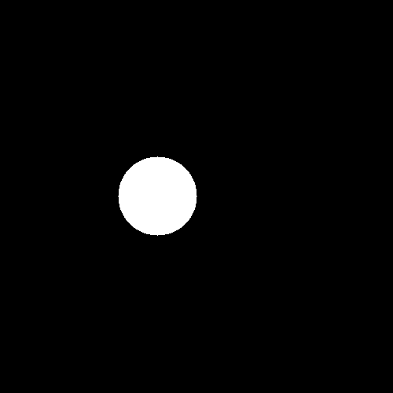||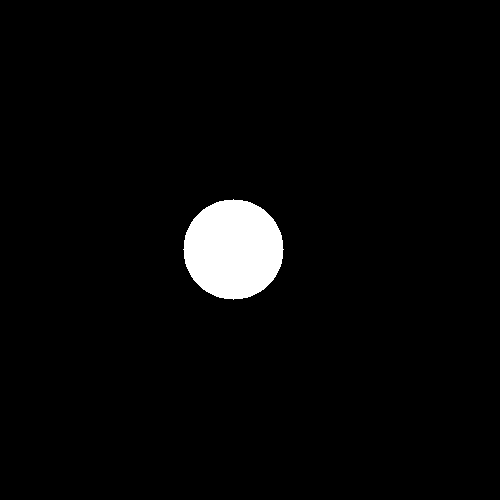|
| ------------- | ------------- | ------------- | ------------- | ------------- |
||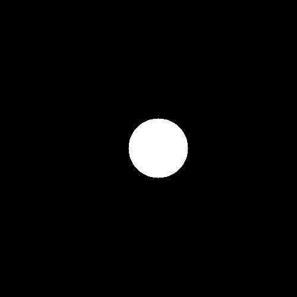||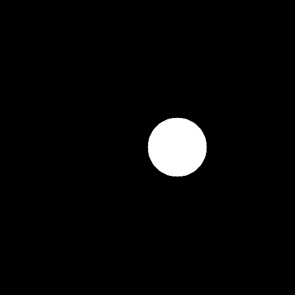|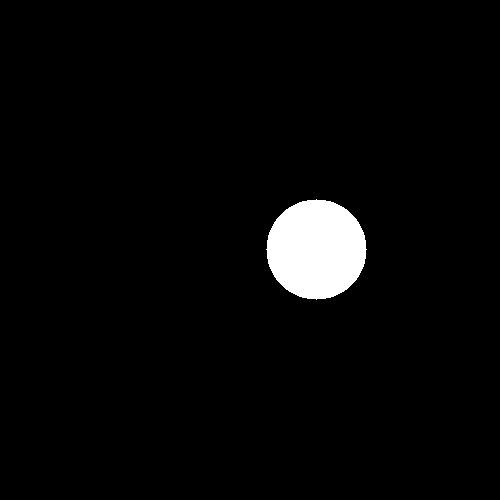|

|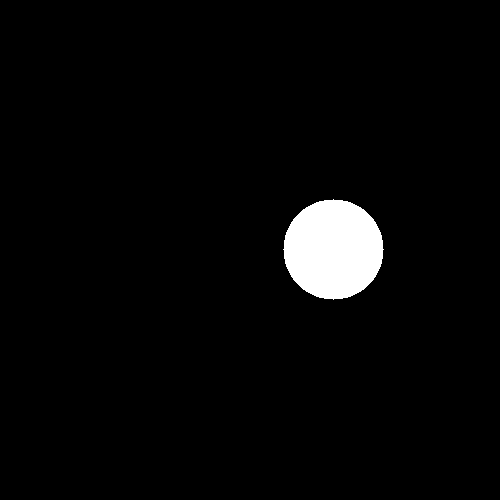||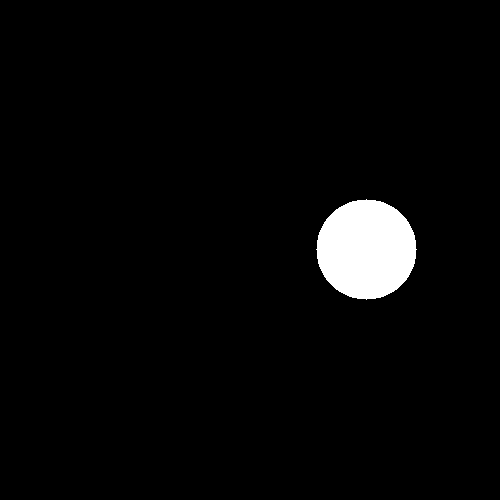|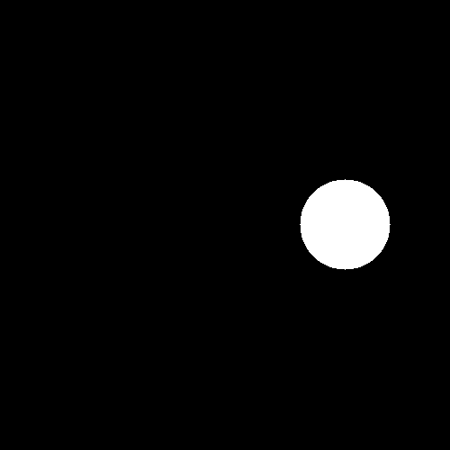|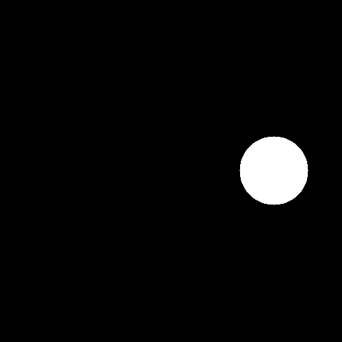|
| ------------- | ------------- | ------------- | ------------- | ------------- |
||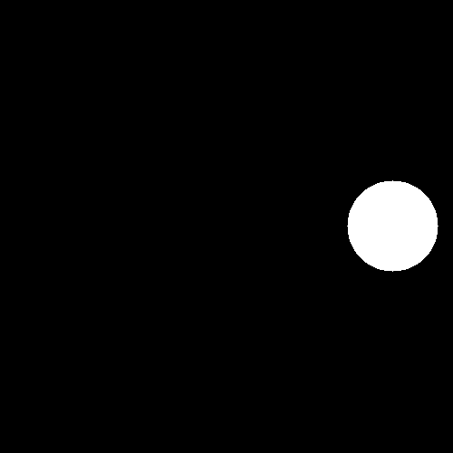|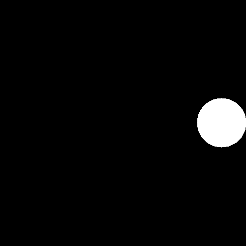|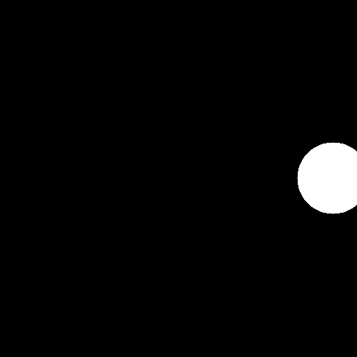|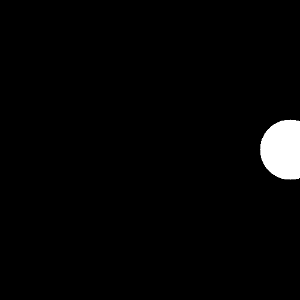|

|**Résultat Gif**|
| ------------- |
||
____
## Exercice 14 - ⭐⭐⭐ Rosace

| Résultat    |
| ------------- |  
|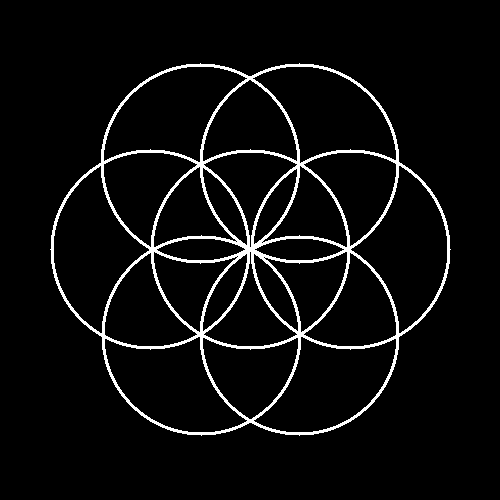|
____
## Exercice 15 - ⭐⭐ Mosaïque

| Avant    |Après| 
| ------------- | :-----------: | 
||| 
____
## Exercice 17 - ⭐⭐⭐ Glitch

| Avant    |Après| 
| ------------- | :-----------: | 
||| 
___
(Je voulais montrer tous mes ratés mais je les ai supprimés au fur et à mesure, je n'avais pas compris 😢)